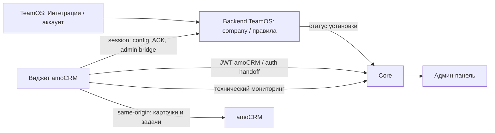

# ADR-0038: Контроль задач — правила в TeamOS, установка и мониторинг в Core

Дата: 2026-10-15; редакция 4 от 2026-10-16. Статус редакции 4: **на review по R00**.
Редакция 3 согласована пользователем; новые решения ниже ещё не являются реализованными API.
[КТ-01.01](https://app.clickup.com/t/869fhtvty) закрыта; [КТ-01.02](https://app.clickup.com/t/869fhtvv7) реализует контракты.
Эта редакция заменяет доставку правил через Core и прямую проверку JWT amoCRM в TeamOS.
Согласование архитектуры не подтверждает готовность runtime или live приёмку.

## Решение и владельцы

| Участник | Ответственность |
|---|---|
| TeamOS | В существующем разделе «Интеграции» блок «Контроль задач» выбранного аккаунта, редактор правил, импорт, публикация и история |
| Backend TeamOS, company | Привязка компании/аккаунта, права, настройки, draft, immutable publication, режим и epoch, прямой runtime API и ACK применения |
| Core, amocrm-pro | Проверка JWT amoCRM и текущей CRM-роли, auth handoff; состояние установки, телеметрия и общий серверный provider CRM-справочников |
| Виджет | Прямое получение правил из backend TeamOS; проверки и задачи через same-origin amoCRM API; технические сигналы напрямую Core |
| amoCRM | Карточки/задачи; в standalone — каталог правил и runtime_config |

Core не хранит копию правил, не доставляет публикации, не фиксирует mode fence,
участвует в установлении сессии, но не в чтении правил. Нет `deliveredToCore`, outbox
публикаций в Core или редактирования правил в инфраструктурной админке.
Сервис `tasks` TeamOS остаётся отдельным доменом. Нового микросервиса не требуется.

## Установка и отображение в Интеграциях

- `installed` — Core подтвердил установку Контроля задач на выбранном аккаунте:
  блок активен, настройки открываются согласно правам пользователя.
- `notInstalled` — Core достоверно подтвердил отсутствие/удаление: блок виден
  неактивным, с объяснением; настройки не удаляются и автоматически не публикуются.
- `unknown` или просроченный снимок — состояние не удалось подтвердить. UI явно
  сообщает об этом, не изображает uninstall и не обещает доступность настроек.

Наличие правил, записи binding или heartbeat не доказывает установку.
Закрытый браузер не означает удаление виджета. Оплата/лицензия не добавляется
как отдельное условие активности в рамках этого этапа.

Backend хранит scoped snapshot статуса Core с revision, checkedAt, freshUntil.
Проверка выполняется при открытии интеграций, истечении кеша и перед мутациями.
Свежий snapshot действует до 5 минут; обычное чтение config не требует сетевого
вызова Core на каждый запрос. Если срок истёк и Core недоступен — новые серверные
выдачи config и изменения не разрешаются (503), локальный ранее проверенный кеш
виджета продолжает работать. Достоверный uninstall/revoke даёт явный отказ и
инвалидирует runtime scope; он не равен timeout. Максимальная задержка обнаружения
uninstall ограничена свежестью кеша, offline-вкладки не гарантируют мгновенный отзыв.

## Авторизация через Core и права

Core проверяет JWT amoCRM существующим widgetauth: подпись, client UUID,
account/user, audience/issuer/expiry и durable replay. Company определяется
из exact account/integration grant; неоднозначная связь запрещена. Browser
companyId не участвует. Актуальную активность CRM-пользователя и CRM admin
для управляющих операций Core проверяет серверным GET users в amoCRM.

Core выдаёт Ed25519 подтверждение сроком до 60 секунд: company/account/installation/
integration/product/actor/generation, purpose, requestId, jti и audience
`teamos-task-control`. JWT amoCRM и client secret остаются в Core. TeamOS хранит
public key Core и отдельный HMAC secret чтения статуса, не secret amoCRM.

Backend проверяет подпись/scope/purpose/TTL и потребляет jti в одной транзакции
с записью подключения или opaque runtime-сессии сроком до 5 минут. В БД — только
hash сессии. Каждый запрос проверяет сессию, текущую связь/epoch/generation и
свежесть установки; network call Core на каждое чтение правил не требуется.
Менеджер не создаётся в TeamOS и не получает роли администратора.

Управление требует текущего owner/admin и policy `taskControl.manage`, чтение
блока — `taskControl.read`. Owner/admin имеют оба права по умолчанию, сотрудник —
ни одного. Company-local task_control_permissions позволяет ограничить права
администратору или дать сотруднику чтение; manage не повышает роль employee.
Права distribution не наследуются. Редактор разрешений относится к .09.

Link/revoke требуют свежего Core admin assertion, привязанного к intent/requestId.
Будущие admin bridge/mode используют отдельные purpose. Runtime session не
заменяет admin proof. Повтор завершённой идемпотентной операции после lost ACK
проверяет текущие TeamOS права, исходный scope/owner и возвращает сохранённый
результат без второго потребления JWT. Клиентский isAdmin не является доказательством.

## Справочники и импорт — решение R00

Managed-справочники читает company через Core сервер-сервер. Общий provider —
модуль существующего Core поверх amoCRM client, OAuth, limiter и кеша, а не новый
микросервис. Product adapter проверяет отдельный grant `task-control.references.read`
и установку Контроля задач; установка или права Distribution не требуются.
Gateway Users с лимитом выдачи 100 не является полным справочником.
Переиспользуются внутренние readers, а не публичная ограниченная проекция.

Это явно заменяет запрет редакции 3 на чтение справочников через Core и зависимость
их обновления от admin bridge. Core по-прежнему не хранит и не доставляет правила.
Company добавляет свою оргструктуру и mapping, хранит намерения выбора и вычисляет
runtime snapshot. CRM-группа и отдел TeamOS — разные идентичности.

Admin bridge остаётся для импорта локального каталога с явным запросом
администратора; импорт создаёт только draft. Browser references не подменяют
серверный источник managed-правил. Standalone читает CRM same-origin и не требует
TeamOS/Core. Динамические отделы TeamOS в standalone не поддерживаются.

Нормативные DTO, матрица прав, сроки свежести, версии, совместимость и сценарии:
[контракт R00](../../../team-os-backend/docs/integrations/task-control-r00-architecture.md).
Примеры в нём — целевой контракт для R01–R11, не обещание уже работающих endpoint.

## Режимы, публикация и откат

Standalone остаётся режимом существующих установок: локальный каталог,
публикация snapshot штатной кнопкой amoCRM, один локальный writer. TeamOS и
Core не являются обязательными для существующего автономного исполнения;
неудача мониторинга не выключает локальные правила.

Managed: единственный writer — company через TeamOS. Для v1 виджет читает immutable
publication; целевой v2 читает вычисленный snapshot этой публикации напрямую backend,
проверяет schema/scope/epoch/runtimeRevision/hash и атомарно
заменяет кеш; локальный редактор выключен. Пустая валидная публикация выключает
проверки, а не запускает fallback. Timeout, удаление каталога или повреждение
managed descriptor не включают standalone автоматически.

Publish атомарно сохраняет publication+audit+idempotency result в company.
ACK приходит напрямую от конкретного runtime instance: он подтверждает одну
вкладку, не всех менеджеров. Rollback создаёт новую возрастающую version.

Переключение — persisted intent в company: подготовка полного набора, проверка
совместимости клиента и установленности, CAS revision/epoch, подтверждение
сохранённого widget descriptor. До завершения смены записи обоих редакторов
приостановлены. Core в протоколе переключения не участвует. При потерянном ACK
читается тот же intent; confirmed не откатывается автоматически по таймеру.
Возврат в standalone экспортирует полный admin snapshot либо явно выбранный
старый набор, сохраняет UID и не использует урезанный менеджерский кеш.
Старые вкладки требуют обновления; 1.0.29 не понимает managed fence.

## Сохраняемая семантика и ограничения

Legacy Rule хранит UID, name, CRM users, pipelines/statuses, customers/customerStatuses,
showModal, denyExit, checkResponsible, enabled, archived. Флаги showModal/denyExit
объединяются OR; выключенные и архивные правила не исполняются. Пустые статусы
покупателей означают все. Покупатели — customers, не contacts/companies.

Guard карточки сделки/покупателя учитывает незавершённую задачу ответственного,
в том числе просроченную. checkResponsible ограничивает применение правила,
но не меняет исполнителя искомой задачи. Список сделок — сделки текущего менеджера.
Список покупателей сохраняет legacy-отличие: ищет задачи текущего пользователя
и читает первые 250 карточек на группу; guard — задачи ответственного карточки.
Подстановка исполнителя и отдельная подтверждаемая задача доступны в форме
сделки. POST создания после неопределённой ошибки автоматически не повторяется.

Ошибки Tasks API/неполная выборка дают unknown и fail-open навигацию. Нет
серверного контроля всех сделок, отчётов нарушений, уведомлений, перехвата mobile,
API или массовых операций. Браузерный guard не является границей безопасности.

Для v2 отдельно сохраняется намерение all/selected/departments/whole-pipeline.
Публикация immutable; фоновые изменения состава создают новый runtimeRevision
в том же scope/epoch без изменения draft и publication version. Новые селекторы
сделок включают только открытые этапы. Старые явные v1 правила не переинтерпретируются.

## Проверенная основа и продолжение

Исходная проверка: Core `8ff2e44`, TeamOS `80e6ca5`, backend `68d96f1`,
rakurs-widgets-new `8c18c05`; скопированная папка rkrs_lead_notasks версии 1.0.29
была untracked. Проверены rules/runtime/snapshot/catalog/settings/task_assignment,
backend amoauth/amo_widget_session/amo_admin_self_login, существующие механизмы
Core widgetauth и мониторинга. Сам факт наличия кода не подтверждает настройку
конкретной установки или применимость JWT на живом аккаунте.

[КТ-01.02: модель и контракт](../../../team-os-backend/docs/integrations/task-control-contract.md).
Релизное продолжение заменено задачами R00–R11 в [КТ-01](https://app.clickup.com/t/869fhtvqm).
После R00: R02 права, R06 lifecycle и R01 runtime; R03 provider; R11 динамика;
R04 импорт, R05 история, R07 диагностика, R08 регрессия; R09 приёмка; R10 выпуск.
Фронтенд-редизайн выполняется отдельно.

## Первая сквозная поставка MVP (2026-10-15)

По согласованию с владельцем реализуется сквозной минимум перед живой приёмкой:
Core proof → короткая сессия → правила в company → настройки TeamOS → исполнение
виджетом 1.1.0. Первичный link и смена режима используют ручной перенос одноразового
Core proof из настроек amoCRM в TeamOS (60 секунд), с проверкой обеих административных
ролей сервером. Автоматическое окно handoff не требуется для первой поставки.

Редактор принимает CRM IDs вручную; сервер проверяет структуру и границы чисел,
но не утверждает существование справочников. Draft сохраняется отдельно от immutable
публикации. В managed новая публикация получается прямым bootstrap каждые 60 секунд;
Core не участвует в доставке. Widget хранит последний корректный snapshot только
в памяти вкладки. Включение TeamOS требует явной настройки amoCRM после server mode switch.
Standalone runtime_config и каталог не перезаписываются, возврат явный.

Автоматический импорт, admin bridge справочников, ACK всех вкладок, расширенная история/
восстановление UI и мониторинг админки остаются последующим объёмом. PR и локальные тесты
не заменяют проверку установленного пакета в живом amoCRM. Инструкция:
[выпуск MVP](../runbooks/task-control-mvp.md).

## Реализация R03: контракт Core references

`GET /internal/task-control/accounts/{accountId}/references` реализует строго
ReferenceSnapshotV1 из R00 §3. Подпись X-Task-Control соответствует status transport,
включает точный URI, запрос не содержит query/body. Capability `references_read`
по умолчанию false; оператор явно включает `--references true` в task-control-grant.
Кеш scoped по company/account/integration/installation/generation/product/schema,
grant revision и OAuth identity; авторизация проверяется до и после каждого чтения.
TTL 5 min от fetchStartedAt, синхронное bounded refresh при возрасте ≥120 s,
30 s deadline и singleflight; максимум 256 cache scopes. Ошибки возвращаются
в `{error:{status,message,code}}`: references_denied (403), invalid_signature (401),
references_too_large (413), references_incomplete/references_unavailable (503).
Неполный ответ не заменяет старый снимок. Customers unsupported подтверждается
только account customers_mode unavailable/disabled; auth/transport failures дают unknown.
Источники CRM: [account](https://www.amocrm.ru/developers/content/crm_platform/account-info),
[customer statuses](https://www.amocrm.ru/developers/content/crm_platform/customers-statuses-api).

### R11: подтверждение совместимости пакета

Core migration 000027 хранит операторское evidence о версии runtime для точной
installation generation; команда `task-control-runtime-descriptor` проверяет
активную установку и пишет аудит. Подтверждённый 1.2.0 разрешает capability
`dynamicRulesV2` в подписанном служебном installation-status; 1.1.4 этого не разрешает.
Клиентские version/capabilities не заменяют это evidence. Reinstall исключает
старое evidence по generation. Правила, intent, resolver, org/mapping и runtime
snapshots остаются в company, без нового бизнес-хранилища в Core.
