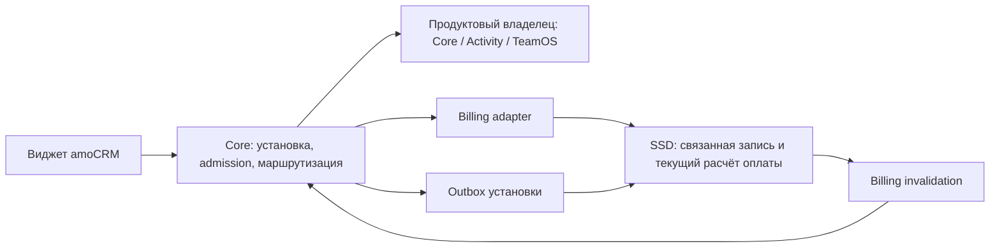

# ПВ-01: архитектурный пакет перехода виджетов на Core

Дата: 2026-10-22. Статус: **готово к review**.
[Этап ПВ-01](https://app.clickup.com/t/1amkccgbvhy).
Все семь ADR ниже — предлагаемые решения для реализации следующих этапов.
Этот пакет не подтверждает готовность API, импортера, биллинга или боевого запуска.

## Зафиксированные границы

Новое публичное Распределение устанавливается сразу в Core. Core хранит
установку и OAuth, TeamOS сохраняет свой бизнес-домен распределения. SSD
получает связанную учётную запись для действующей оплаты и разрешённых
существующих операций через серверный адаптер. Эта запись не запускает
старый виджет, не содержит копию OAuth и не создаёт коммерческие эффекты
просто из-за повторной синхронизации.

Для существующих продуктов старый и новый runtime временно сосуществуют
по разным аккаунтам. Перенос продукта и передача OAuth — разные операции.
Права покупки сохраняются по стабильному коммерческому ключу, разрешение
исполнения проверяется по текущим установке, поколению, владельцу и policy.

Диаграмма показывает логические обязанности. Она не вводит новый микросервис
для каждой стрелки и не обещает синхронную распределённую транзакцию.

## Решения и соответствие задачам

| Задача | ADR | Проверяемый результат проектирования |
| --- | --- | --- |
| [ПВ-01.01](https://app.clickup.com/t/1amkccgbvhz) | [0039: OAuth](../adr/0039-widget-migration-oauth-ownership.md) | Существующие client_id сохраняются по умолчанию; новые интеграции — явное исключение. Передача credentials, callbacks и возврат не создают второго refresh-owner |
| [ПВ-01.02](https://app.clickup.com/t/1amkccgbvj0) | [0040: исполнение](../adr/0040-product-routing-ownership.md) | Scope account+product, функции только для Activity, state machine, epochs, source fence и receipts, читатели и поведение при отказе |
| [ПВ-01.03](https://app.clickup.com/t/1amkccgbvj1) | [0041: установки](../adr/0041-core-ssd-installation-bridge.md) | Три сценария, минимальная проекция SSD, версии состояния и метаданных, transport/state hashes, outbox/inbox, scoped signed HTTP |
| [ПВ-01.04](https://app.clickup.com/t/1amkccgbvj2) | [0042: оплата](../adr/0042-core-ssd-billing-adapter.md) | SSD authoritative resolver, allowlist адаптера, typed entitlement, identity/generation, TTL/grace, invalidation с двумя revision |
| [ПВ-01.05](https://app.clickup.com/t/1amkccgbvj4) | [0043: нагрузка](../adr/0043-hybrid-amocrm-outbound-budget.md) | Общий PostgreSQL coordinator, узкий TryAcquire, foreground/background, 429, отказ и процедура rollout |
| [ПВ-01.06](https://app.clickup.com/t/1amkccgbvj5) | [0044: перенос и возврат](../adr/0044-product-cutover-and-rollback.md) | Паспорт волны, таблицы данных/операций, граница импорта, relay поздних событий, обратный перенос и критерии пилота |
| [ПВ-01.07](https://app.clickup.com/t/1amkccgbvj6) | [0045: размещение](../adr/0045-widget-product-placement.md) | Два способа подключения и выбор владельца для каждой из 13 продуктовых позиций |

## Что нужно реализовать в следующих этапах

| Потребитель | Обязательная реализация / уточнение объёма |
| --- | --- |
| ПВ-02, РС-12 | Общий loader/runtime/build; browser identity; совместимость старого UI/URLs; публичный callback отдельно от текущего state-based flow |
| ПВ-03.01/.02 | Не только таблица и cache: transfer state machine, local durable fences всех исполнителей, source/target receipts, CAS и операторское восстановление |
| ПВ-03 — отдельный результат OAuth | Защищённый staging importer, credential-owner/epoch, ограждение refresh/callback, публичный intake journal, типизированные Gateway operations для остающихся функций. В текущем плане нет самостоятельной задачи реализации этого результата |
| ПВ-03.03/.04/.05 | Технический путь записи без лишних model hooks; коммерческий intent отдельно; mirror inbox/outbox; account metadata revision; mixed-function display; generation и routing changes |
| ПВ-03.06/.07 | Authoritative PaymentContext без legacy cache; типизированные причины; coverage всех коммерческих writers revision/outbox; cache invalidation и поколение grant |
| ПВ-03 — отдельный результат бюджета | Общий TryAcquire и SSD transport-level adapter, включая retries/pagination/CLI; нагрузочный rollout. Одних правил или метрик ПВ-03.09 недостаточно; нужна самостоятельная реализация |
| ПВ-03.08/.09/.10 | Совместимый ingress, durable relay после границы импорта, сверка и ограниченные метрики; команды восстановления и наблюдаемое состояние оператора |
| ПВ-04 / ПВ-05 | Заполненные паспорта конкретных продуктов, forward/reverse import, сохранение operation identity, сценарии старой вкладки/автоматизации, доказанный возврат |
| ПВ-07 | Google OAuth/refresh и запись передаются владельцу Google-export вместе. Telegram может временно использовать SSD adapter; это не отключение SSD |
| РС-12 / НП-01 | Новая установка и Billing на двух аккаунтах; выбранный процесс оплаты, коммерческие условия. Нет ожидания миграции старого Распределения |

ПВ-01 не реализует перечисленный код и не изменяет остальные этапы автоматически.
Перед началом ПВ-03 в backlog нужно выделить два отсутствующих результата:
передачу OAuth и общий исходящий бюджет; расширить приёмку существующих задач
согласно таблице. Тексты ADR не заменяют проверяемые задачи реализации.

## Начальные параметры для review

Это явно предложенные инженерные настройки, не согласованные тарифы/SLA:

- route snapshot TTL: 60 секунд; локальный execution fence обязателен независимо
  от свежести cache, target не активируется без source quiesce ACK;
- billing TTL: 5 минут; grace до 24 часов от последнего authoritative allow,
  ограниченный известным сроком права; без прежнего allow — pending;
- общий исходящий budget: 6 rps на account+client_id, 40 на account;
  фон 1/5 rps; TryAcquire через Core PostgreSQL, без новой Redis-зависимости;
- доставка mirror: backoff до 5 минут, тревога после 15 минут; сверка пилота
  каждые 15 минут и полная суточная сверка;
- наблюдение пилота: не менее двух рабочих дней и полного цикла самой редкой
  включённой автоматизации; измеренные SLO задаются паспортом продукта.

Числа настраиваются при реализации/приёмке; изменение коммерческих правил
не выводится из этих defaults. Тарифы, новый trial и модель подписки остаются НП-01.

## Подтверждённые разрывы текущей реализации

1. Core SaveInstallation сразу активирует установку и ставит webhook reconcile;
   текущий callback требует state. Для безопасного импорта нужны отдельные пути.
2. SSD model hooks и InstallWidgetAction имеют коммерческие побочные действия;
   отсутствие paid_to может назначить новый trial. Зеркало не является обычным install.
3. Legacy UI paid-status, AccountWidget::check и resolver::isPaid имеют различия.
   Новый access grant нельзя получать простым парсингом ответа интерфейса.
4. Старые SSD caches могут вернуть устаревшую оплату после очистки Core cache.
   Нужны authoritative reads и полный охват writers, включая mass updates.
5. Независимые исходящие limiter Core и SSD не дают общего бюджета; retries
   необходимо учитывать у фактического транспорта, не только у PHP callback.

Каждый факт имеет ссылку на код в соответствующем ADR. Код сверялся локально;
production конфигурация, secrets и действующие клиентские установки не читались.

## Проверка пакета и оставшиеся внешние условия

Проектные документы прошли перекрёстную проверку границ/отказов. Устранены
окно позднего ingress после snapshot, гонка public callback после handoff,
grant прежнего поколения, конфликт версий общих metadata и смешение event/state
hash. Согласованы Activity function_routes и обновление зеркала при смене owner.
Это design review, не доказательство работающего протокола.

Нужны до соответствующей реализации/пилота:

- решение по требованиям удалённого кода/модерации из РС-12.19;
- подтверждение реальных integration IDs, доступа к настройкам/секретам и
  совместимости выбранного callback для каждого переносимого продукта;
- проверка соответствия названия «Дата перехода в статус» legacy-модулю:
  StageTime называет себя «Время на этапе»; нельзя угадать mapping по имени;
- решение НП-01 о коммерческих условиях; выбор требуемых операций checkout;
- фактические замеры нагрузки, тесты восстановления и согласование пилотных клиентов.

Эти условия не требуют выдумывать production данные при проектировании.
Приёмка ПВ-01 означает принятие архитектурных решений; приёмка следующих
этапов отдельно подтверждает их реализацию и поведение на целевой среде.
